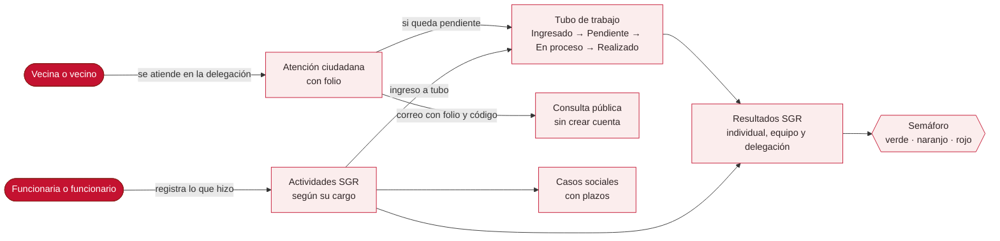
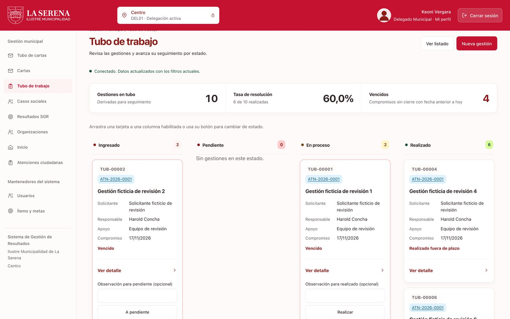
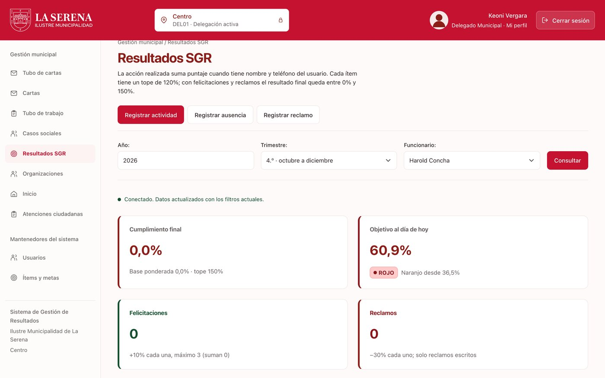
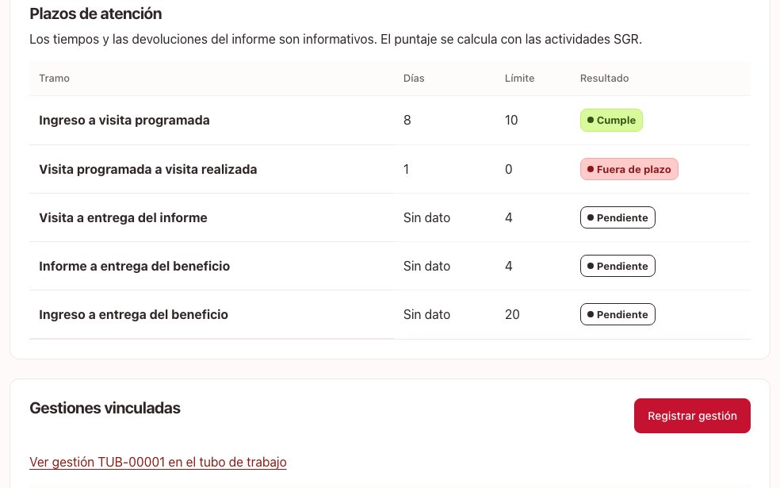
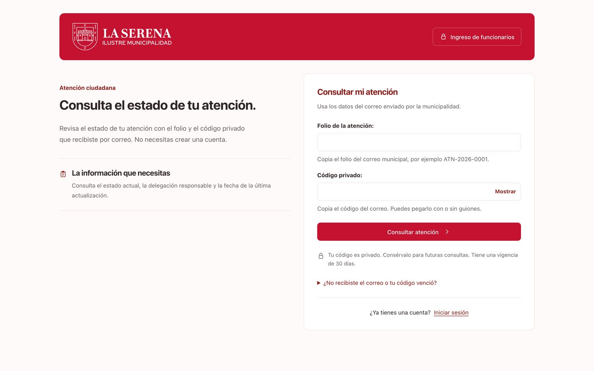

<p align="center">
  
</p>

<p align="center">
  
  
  
  
  
</p>

# SGR · Sistema de Gestión de Resultados

**La plataforma con que las delegaciones municipales de La Serena registran lo que hacen por sus vecinos, siguen cada solicitud hasta resolverla y miden el cumplimiento de la matriz SGR, al día.**

Antes, la matriz SGR vivía en una planilla de 24 hojas por trimestre que cada delegación llenaba a mano, y el tubo de trabajo se seguía con colores y texto tachado. Las reglas de la coordinación (máximo siete ingresos diarios, cierre semanal, sin teléfono no hay puntaje…) no se podían hacer cumplir. El SGR reúne todo en un solo sistema web: cada cuenta trabaja sobre su delegación, cada cambio queda registrado y **las reglas las valida el servidor, no la buena voluntad**.

> Proyecto Integrado de INACAP La Serena, construido sobre los requerimientos de la Coordinación de Delegaciones de la Ilustre Municipalidad de La Serena.

---

## Índice

- [Cómo funciona](#cómo-funciona)
- [Qué puede hacer cada persona](#qué-puede-hacer-cada-persona)
- [Módulos](#módulos)
- [Reglas de la matriz SGR](#reglas-de-la-matriz-sgr)
- [Así se ve](#así-se-ve)
- [Ponerlo en marcha](#ponerlo-en-marcha)
- [Seguridad y privacidad](#seguridad-y-privacidad)
- [Calidad](#calidad)
- [Documentación](#documentación)

---

## Cómo funciona



1. **La atención.** Quien atiende registra al vecino con su RUT y recibe un folio. Si el vecino dejó su correo, recibe el folio y un código privado para consultar su caso sin crear una cuenta.
2. **El tubo de trabajo.** Lo que no se resuelve en el momento pasa al tubo y avanza de estado arrastrando su tarjeta. Cada cambio queda en un historial con autor, fecha y observación.
3. **Las actividades SGR.** Cada funcionario registra lo que hizo, en los ítems de su cargo. El sistema indica si suma puntaje y, si no, por qué.
4. **Los resultados.** El cumplimiento se calcula solo: por persona, por equipo y por delegación, con un semáforo que compara el avance con lo esperado al día de hoy.

Todo se actualiza **en tiempo real**: si alguien mueve una gestión o registra una actividad, las pantallas abiertas de su delegación se refrescan sin recargar la página.

---

## Qué puede hacer cada persona

| Rol | En pocas palabras |
| --- | --- |
| **Superadministrador** | Administración técnica: todas las delegaciones, cuentas, roles y consola. |
| **Coordinador** | Mira la comuna completa: delegaciones, metas, catálogos y atenciones. |
| **Delegado Municipal** | Dirige su delegación: equipo, metas, verificación de actividades, ausencias, reclamos y felicitaciones. |
| **Operador / Funcionario** | Atiende, registra actividades y avanza las gestiones de su delegación. |
| **Consultor** | Consulta y exporta la información de su delegación, sin modificarla. |
| **Cliente** | El vecino con cuenta: ve solo sus propias atenciones. |

Cada cuenta ve únicamente su delegación. Un registro ajeno no se puede abrir, editar ni exportar, aunque se conozca su dirección.

---

## Módulos

| Módulo | Para qué sirve |
| --- | --- |
| **Atenciones ciudadanas** | Registro de cada atención con tipo, subatención, RUT y folio. Exportación a Excel con los filtros aplicados. |
| **Consulta del vecino** | El vecino ve el estado de su atención con su folio y un código enviado por correo. |
| **Tubo de trabajo** | Tablero de seguimiento con arrastrar y soltar, plazos, vencidos y avance por colaborador. Al escribir un RUT avisa si el solicitante es funcionario y cuál es su cargo. |
| **Cartas de oficina de partes** | Tablero propio para las cartas recibidas: pronunciamiento, derivación y estado. |
| **Casos sociales** | Seguimiento de cada caso del gestor social: visita, informe y beneficio, con sus plazos. |
| **Actividades SGR** | Registro diario por cargo, con código de verificación y motivo de puntaje visible. |
| **Resultados SGR** | Cumplimiento por ítem, semáforo del equipo, resultado de la delegación (hoja SALON) y metas individuales. |
| **Organizaciones comunitarias** | Juntas de vecinos y organizaciones funcionales por delegación y subfamilia; la base entregada suma 2.687. |
| **Usuarios** | Cuentas de la delegación con su ficha completa, cargo municipal y foto. |
| **Mi perfil** | Datos de contacto, foto y la lista de funciones del cargo según el descriptor 2026. |

---

## Reglas de la matriz SGR

El sistema aplica las diez reglas que la Coordinación de Delegaciones envió a los equipos:

| # | Regla | Cómo la aplica el sistema |
| :-: | --- | --- |
| 1 | Lo que pide el delegado no se contabiliza | Al reconocer su RUT, la gestión queda como «otra gestión». |
| 2 | Sin nombre y teléfono del usuario no hay puntaje | Se exige el teléfono y se muestra el motivo en cada registro. |
| 3 | Máximo siete ingresos diarios | El octavo ingreso del día se rechaza. |
| 4 | La semana se cierra el lunes siguiente | Las fechas fuera de la semana abierta no se aceptan. |
| 5 | Coordinar no suma; realizar sí | Se distingue la acción realizada de la coordinación. |
| 6 | Registrar para cumplir no sirve | El delegado puede marcar una actividad como no válida. |
| 7 | Tope de 120% por ítem | Sobre ese tope el ítem deja de sumar. |
| 8 | Felicitaciones con respaldo formal | Solo las informa el delegado: +10% cada una, máximo tres. |
| 9 | Las ausencias ajustan la meta | Licencias, vacaciones, emergencias y otros permisos descuentan días. |
| 10 | El resultado es de equipo | Resultado de la delegación con los ponderadores de la hoja SALON. |

Además: reclamos −30%, resultado final entre 0% y 150% y semáforo verde, naranjo desde el 60% del objetivo, rojo bajo eso. Las decisiones tomadas donde la planilla se contradice, con la celda que respalda cada una, están en [docs/proyecto-integrado-3.md](docs/proyecto-integrado-3.md#reglas-decididas-a-partir-de-la-matriz-25-de-noviembre-de-2026).

---

## Así se ve

<table>
  <tr>
    <td width="50%"><br><sub><b>Tubo de trabajo.</b> Cada gestión avanza arrastrando su tarjeta.</sub></td>
    <td width="50%"><br><sub><b>Resultados SGR.</b> Cumplimiento y semáforo al día de hoy.</sub></td>
  </tr>
  <tr>
    <td width="50%"><br><sub><b>Casos sociales.</b> Plazos de visita, informe y beneficio.</sub></td>
    <td width="50%"><br><sub><b>Consulta del vecino.</b> Con folio y código, sin crear cuenta.</sub></td>
  </tr>
</table>

<sub>Las capturas usan datos ficticios de demostración.</sub>

---

## Ponerlo en marcha

### Si el equipo ya está preparado

```bash
source .venv/bin/activate
docker compose up -d mysql redis mailpit
daphne -b 127.0.0.1 -p 8001 config.asgi:application
```

| Servicio | Dirección |
| --- | --- |
| Aplicación | <http://127.0.0.1:8001> |
| Buzón de correo de prueba (Mailpit) | <http://127.0.0.1:8025> |

Las cuentas de prueba están en `.private/cuentas-demo.json`, fuera de Git. Se entregan por un medio privado.

### Desde cero

Necesitas Python 3.11 o superior, [`uv`](https://docs.astral.sh/uv/), Docker con Compose y las bibliotecas de compilación de `mysqlclient` ([detalle por sistema operativo](docs/guia-tecnica.md#instalación-desde-cero)).

```bash
uv venv --python 3.11 && source .venv/bin/activate
uv pip install -r requirements-dev.txt
python scripts/configure_local.py        # crea .env con secretos aleatorios
docker compose up -d mysql redis mailpit # MySQL 8.4, Redis 7.4 y Mailpit
python manage.py migrate
python manage.py seed_demo               # datos ficticios de demostración
daphne -b 127.0.0.1 -p 8001 config.asgi:application
```

### Cargar la información de la municipalidad

Cada comando simula los cambios y solo los guarda con `--aplicar`:

```bash
python manage.py cargar_matriz_sgr --delegacion ID --aplicar     # ítems, metas y ponderadores por cargo
python manage.py cargar_catalogo_social --todas --aplicar        # catálogo de atención social
python manage.py importar_organizaciones "base JJVV.xlsx" --todas --aplicar
python manage.py asignar_delegado NOMBRE_DE_USUARIO              # atribución especial del delegado
```

### En la nube

El sistema está preparado para AWS EC2 con Nginx, HTTPS de Let's Encrypt, MySQL y Redis persistentes y Daphne sin privilegios de administrador. Nginx debe dejar pasar las conexiones `/ws/` para el tiempo real. El paso a paso está en la [guía técnica](docs/guia-tecnica.md#aws-preparación-y-puesta-en-marcha).

---

## Seguridad y privacidad

- **Cada delegación ve lo suyo.** El servidor filtra cada consulta, detalle, edición, exportación y aviso en tiempo real por delegación. Lo ajeno responde «no encontrado».
- **Permisos por acción.** Ver, crear, editar y archivar se conceden por rol. El navegador no decide la delegación, el responsable, el folio ni el puntaje.
- **Datos personales cuidados.** La consulta pública no muestra nombre, RUT ni descripción. Los avisos en tiempo real no llevan datos del registro. Las fotos de perfil no tienen dirección pública: las ve su dueño, el delegado que administra la cuenta y la administración técnica.
- **Validaciones del lado del servidor.** RUT con dígito verificador, fechas de la semana abierta, teléfonos, fotos JPEG o PNG de hasta 2 MiB revisadas por completo y protección CSRF en cada formulario.
- **Sin secretos en Git.** Contraseñas, credenciales de correo, respaldos y cuentas de prueba viven en `.env` y `.private/`, ambos excluidos.

---

## Calidad

```bash
pytest tests_django                                 # más de 370 pruebas sobre MySQL y Redis reales
python manage.py makemigrations --check --dry-run   # el modelo y las migraciones coinciden
python manage.py check --deploy                     # revisión de seguridad de Django
```

- Las pruebas recorren permisos por rol, aislamiento entre delegaciones, reglas de la matriz, cálculos del semáforo, tiempo real y arrastre en el navegador.
- Las páginas se revisaron en navegador a 375, 768, 1280 y 1600 px de ancho, sin errores de JavaScript ni elementos desbordados.
- Los colores de texto cumplen el contraste mínimo de legibilidad (4,5:1).

No ejecutes dos suites de pruebas al mismo tiempo: comparten la base de pruebas.

---

## Documentación

| Documento | Contenido |
| --- | --- |
| [docs/proyecto-integrado-3.md](docs/proyecto-integrado-3.md) | Tubo, matriz SGR, organizaciones, reglas decididas y su respaldo en la planilla. |
| [docs/guia-tecnica.md](docs/guia-tecnica.md) | Instalación detallada, roles, consulta ciudadana, tiempo real, verificación y AWS. |
| [docs/tablero-canvas.md](docs/tablero-canvas.md) | Tableros de seguimiento y arrastrar y soltar. |
| [diagramas/](diagramas/) | Casos de uso, clases, modelo de datos y trazabilidad de requerimientos. |
| [assets/municipal/README.md](assets/municipal/README.md) | Identidad visual: logo, paleta institucional y tipografía. |

---

<p align="center">
  <sub>Ilustre Municipalidad de La Serena · Coordinación de Delegaciones · INACAP La Serena</sub><br>
  <sub>Paleta institucional: rojo heráldico <code>#C41230</code>, rojo oscuro <code>#8B1D19</code> y rojo luminoso <code>#DB3334</code>.</sub>
</p>
